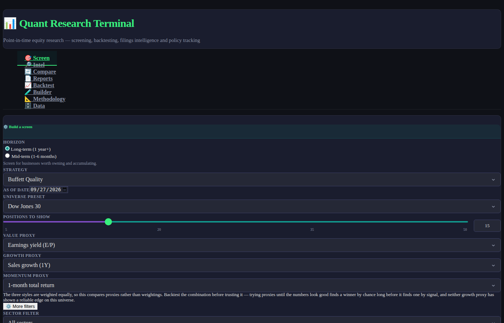
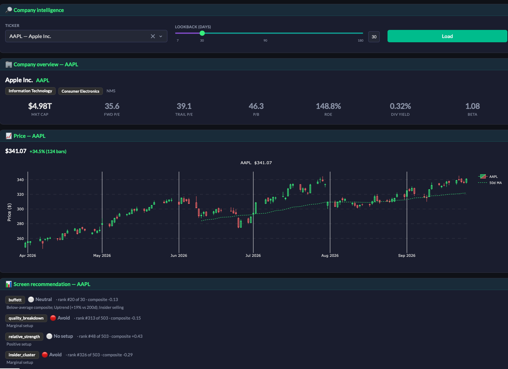

# Quant Research Terminal

A local web app for **mid- and long-horizon** equity research. It stores everything it fetches, so you can re-run a screen **as of any past date**, compare today against a month or a year ago, and backtest a strategy without accidentally using information that did not exist yet.

Runs on your machine — `python3 app.py`, then open `http://localhost:8050`; [reachable from your phone](docs/remote-access.md) through Tailscale once you set a login. Uses only free data sources; **no API keys required** for data, screening, or backtesting. An optional [AI analysis layer](#optional-ai-analysis-layer) adds natural-language interpretation when a Gemini or Anthropic key is set.

```bash
bash run.sh          # install, create the database, load the Dow 30, launch
```

<p align="center">
  
</p>
<p align="center"><em>Screen tab: Buffett Quality on the S&P 500 — ranked results with sector mix and signal breakdown</em></p>

<p align="center">
  
</p>
<p align="center"><em>Intel tab: company overview, candlestick chart with 50d MA, and screen recommendations across strategies</em></p>

---

## Two horizons, two different jobs

The app treats these as separate questions rather than one ranked list, because they are.

| | **Long-term** (1 year+) | **Mid-term** (3–6 months) |
|---|---|---|
| Question | *Is this business worth owning?* | *Is this worth holding for the next two quarters?* |
| Driven by | Returns on capital, balance sheet, valuation, earnings durability | What lasts that long: 6–12 month momentum, earnings drift, cash returned to owners, insider buying |
| Output | Rank, signal, and the reasoning behind it | Entry, stop, target, six-month time stop, position size |
| Exit | A broken thesis — no price level | Stop hit, target hit, six-month limit, or dropping out at the half-yearly review |
| Rebalance | Every six months | Every six months, with stops in between |
| Strategies | Buffett Quality, Quality Momentum, Style Factors, Insider Conviction, AI Earnings Review, Total Shareholder Yield, **Multi-Strategy Consensus** | **Balanced (Value + Momentum + Quality)**, Momentum + Trend, 52-Week Breakout, Low-Vol Relative Strength, Post-Earnings Drift, Insider Cluster; shorter entry setups: Pullback, Mean Reversion |

**Do they beat SPY?** Measured, not assumed — and the answer is *not
provably*. **[docs/strategy-research.md](docs/strategy-research.md)** tests
every strategy on the S&P 500 from 2020 over 3- and 6-month holds. Held six
months, with costs, Buffett Quality, Shareholder Yield, Momentum + Trend and
the Consensus finished 0.4–1.4% a year ahead of SPY and the Balanced blend
slightly behind — margins too small to distinguish from luck. Rotated every
three months, all of them did worse, which is why both horizons now
rebalance half-yearly. Value screens won in 2020–2023 and momentum screens
afterwards; neither did both.

A shortlist (and a backtest portfolio) never takes more than 30% of its
names from one sector: the top of a ranking can be a single theme, and a
theme reverses all at once.

Position sizes are **percentages of portfolio** implied by a risk budget and the stop distance — a wider stop earns a smaller position. The app knows nothing about your account and never asks.

---

## How a run works: pull, then read

Every run has two phases, always in this order.

```
┌─ 1. PULL ────────────────────────────────────────────────────┐
│  data/sync.py asks each source: are you inside your window?  │
│    fresh  → skip, no network call                            │
│    stale  → fetch and write to SQLite                        │
└──────────────────────────────┬───────────────────────────────┘
                               ▼
┌─ 2. READ ────────────────────────────────────────────────────┐
│  quant/ computes from the database only. No network access   │
│  exists on this path, so a read cannot surprise you.         │
└──────────────────────────────────────────────────────────────┘
```

Each source declares how long its data stays good, chosen from how fast the underlying thing actually changes:

| Source | Refresh after | Why |
|---|---|---|
| Daily bars | 12h, and only once the session has closed | A bar does not exist before the close |
| SEC XBRL facts | 12h | New facts appear only when a filing lands |
| SEC filings / 8-K | 12h | Same |
| Form 4 insiders | 24h | Filed within two business days of a trade |
| News | 3h | The only genuinely fast-moving source |
| Federal Register | 12h | Publishes on business mornings |
| Market-cap snapshots | 24h | Rate-limited; best effort |
| Index membership | 7d | Changes on scheduled reviews |
| Security master | 30d | CIK and SIC are effectively static |

Staleness is tracked **per ticker**, so a universe where 490 of 500 names were updated this morning fetches only the other ten.

### Why this makes it fast

Built factor frames are cached on disk, keyed by universe, as-of date, and a *data version* derived from the store — row counts and newest `filed`/`date`. Ingest anything and the version moves and the cache is bypassed; ingest nothing and the previous frame is served. So the two phases compose:

```
first run on a cold store   pull 118k rows, build factors    ~76s
same run, nothing stale     no fetches, cached factors        ~0.2s
```

That is not a staleness trade. A cache hit is only possible when the store is provably unchanged, so the fast answer and the slow answer are the same answer.

Historical as-of dates skip the pull entirely — fetching *today's* data cannot inform a past date, and would only invalidate caches.

```bash
python cli.py freshness
```

shows what is fresh, what is stale, and what the next run would fetch. The Data tab shows the same thing.

---

## What makes the numbers trustworthy

Most of the engineering here is about not fooling yourself.

**Point-in-time everything.** Every SEC fact carries a `filed` date, and all reads are gated on it. Apple's quarter ending 2026-06-27 was not public until 2026-07-31 — a five-week gap that would silently inflate any backtest that used the period end instead.

**Survivorship bias is handled.** Index membership is reconstructed historically from Wikipedia page revisions and cross-checked against the ETF's own SEC N-PORT filings. The S&P 500 on 2021-06-01 contained ABMD, ATVI, XLNX and 92 other names that are gone today; scoring a 2021 date against today's list would quietly load the test with winners.

**XBRL duration disambiguation.** Apple's FY2026 Q3 returns *two* `NetIncomeLoss` facts with the same end date and the same filing date: 29,789M for the quarter and 101,464M for the nine months to date. Only `period_start` separates them. Summing naively overstates TTM by about 3.4×.

**Restatements respect what was knowable.** A figure revised in August is not visible to a screen dated in June.

**Adjusted and unadjusted prices are never mixed.** Stops and targets derive from adjusted closes, so the high/low bars used to detect hits are scaled onto the same basis. Comparing an adjusted stop against a raw high made every trade appear to hit its target instantly — and turned a Sharpe of 1.6 into a fictional 3.3.

**Predictive power is reported, not just returns.** Every backtest shows rank IC alongside CAGR, and the UI flags it when the correlation is near zero — which means any outperformance came from a few positions rather than from the ranking working.

### How signals are graded

Each strategy's composite is an average of sector-relative z-scores, so its
spread depends on how many factors it blends. Buy / Hold / Sell tiers are
therefore set on the composite's **percentile** within the screened universe
(top decile, top quartile, above median, …), which makes a "Buy" mean the same
thing in an eleven-factor strategy as in a five-factor one.

**Deteriorating Quality is an avoid list.** Rank 1 is the *worst* name. It
gets avoid/caution labels and no trade plan, it is kept out of the daily
brief's consensus and Buy counts, it appears in its own "Avoid list" section
(flagging anything you hold or watch), a holding that lands on it raises an
alert, and its live track record counts it as working when its names *lag*
the market.

### How the backtests trade

| | Long horizon (`run_backtest`) | Mid horizon (`run_trade_backtest`) |
|---|---|---|
| Signal | after the close of a real session — the last session of each month/quarter, never a weekend date | after the close of the last session of each month |
| Entry | the close one session later (`execution_lag=1`) | market orders at the next open; pullback limits only if a later bar trades down to them within 5 sessions, else the order expires |
| Exit | the next rebalance fill | stop (checked first), target, or time stop — never on the signal day's own bar; a gap through the stop fills at the open |
| Capital | weights sum to 1; turnover measured against *drifted* weights | gross exposure capped at 100%; a name already held or on order is not bought twice |
| Curve | marked to market daily | marked to market daily (open losses count in the drawdown) |
| Costs | commission + slippage on every unit traded | the same, on entry and exit |

Sharpe is the textbook mean excess return over volatility; Sortino uses downside deviation; the risk-free rate is the average 3-month T-bill over the backtest window (from FRED), not a fixed 5%. The IC research forward returns start at the signal close.

**One limitation the code cannot fix:** the free price source has no history for delisted tickers. Point-in-time membership puts companies that later failed or were acquired back into the universe, but with no prices they cannot pass the liquidity filter, so they are never picked. The availability check refuses windows where that gap is large; it is still worth knowing that older results lean optimistic.

---

## Data sources — all free, no keys

| Source | Provides | Backtestable? |
|---|---|---|
| **SEC EDGAR XBRL** | Point-in-time fundamentals, every fact filing-dated | ✅ full history |
| **SEC submissions** | 8-K corporate events by item code, Form 4 insider trades, SIC sector | ✅ full history |
| **SEC N-PORT** | ETF holdings, for cross-checking index membership | ✅ 2019+, ~58-day lag |
| **MediaWiki revisions** | Historical index constituents | ✅ ~2007+ |
| **Yahoo chart API** | Daily OHLCV | ✅ full history |
| **Wikimedia pageviews** | Retail attention proxy | ✅ full daily history |
| **Federal Register** | Rules and executive orders, mapped to sectors | ✅ full history |
| **FRED** (keyless CSV, or API with `FRED_API_KEY`) | T-bills, Treasuries, curve, high-yield spread, VIX, Fed funds | ✅ full history |
| **Earnings calendar** — Nasdaq's public calendar; Yahoo (via yfinance) for your portfolio and watchlist names it misses; Finnhub first if `FINNHUB_API_KEY` is set | Upcoming report dates. Anything still missing is estimated from the company's own 8-K Item 2.02 cadence and labelled as an estimate | ⚠️ forward only |
| Yahoo / Google News RSS | Company coverage, sentiment, direction extraction | ⚠️ **forward only** |

The last row is the honest exception: free news APIs return only recent items, so news signals work live from day one but cannot be backfilled. Everything else carries a filing or publication date and is backtestable immediately — which is why the strategies lean on filings rather than headlines.

### On sector classification

Sectors come from the SEC's SIC codes, not from `yfinance.info`. That endpoint is the most heavily rate-limited provider in the stack; during the first full ingest of this project it returned nothing at all, which left every name classified `Unknown` and silently collapsed the sector-relative z-scores into one meaningless bucket. SIC is coarser than GICS and imperfect at the margins, but a mostly-right sector beats a universally absent one.

---

## News, filings and policy intelligence

Sentiment is the least interesting output here. The extraction targets **what changes a thesis**:

- **Guidance** — raised, lowered, reaffirmed, withdrawn, beat, missed
- **Capital allocation** — buybacks, dividend increases and cuts
- **Strategy** — M&A, divestitures, restructuring, partnerships
- **Management** — CEO/CFO/board changes (8-K item 5.02 catches these deterministically)
- **Legal & regulatory** — litigation, investigations, approvals
- **Policy** — Federal Register rules and executive orders, mapped from issuing agency to affected sectors

Sentiment uses the **Loughran-McDonald** financial lexicon rather than a general-purpose one, because in financial text "liability", "cost" and "depreciation" are neutral and everyday sentiment tools read them as negative. Event direction feeds back into the score, so "Management raised guidance and announced a buyback" reads as positive even though it contains no sentiment vocabulary at all.

All of this works offline with no keys.

### Optional: AI analysis layer

Set one key in `.env` and an interpretation layer appears on top of the numbers:

```bash
GEMINI_API_KEY=...        # aistudio.google.com/apikey — no extra package needed
# or
ANTHROPIC_API_KEY=...     # needs: pip install anthropic
```

`LLM_PROVIDER` accepts `auto | gemini | anthropic | off`. Under `auto` Gemini wins when its key is present; naming a provider explicitly never silently falls back to the other vendor, since that would bill an account you did not choose.

| Tab | What it adds |
|---|---|
| **Screen** | Why the strategy ranked these names, read off the actual factor exposures |
| **Research** | A candid read of the backtest — including saying so when rank IC shows the ranking had no predictive power |
| **Intel** | Cross-article synthesis: company direction, guidance, capital allocation; plus a sector read on recent policy |
| **Compare** | What changed between two run dates, and which factors drove the rotation |
| **Data** | Whether the layer is live, and on which backend |

**The commentary panels never change a score, a rank, or a trade level.** Those stay deterministic and reproducible from the formulas in the Methodology tab — the model is handed *computed* figures and asked to interpret them, so a hallucination can mislead a reader but cannot corrupt a backtest. Every panel is labelled with the model that wrote it.

**The one place AI does enter scoring is opt-in and dated:** the *earnings reviews* below feed the `LLM_EARNINGS_VIEW` factor, which only the AI Earnings Review strategy and one vote of the Multi-Strategy Consensus use. Every other strategy is untouched.

### AI earnings reviews

For each new results filing (8-K Item 2.02) the press release is pulled from EDGAR and read by the configured model together with the computed figures — growth, margins, ROIC, valuation yields, the market's reaction, the consensus EPS estimate and recent headlines. It answers one question for a 6–18 month holder, *is this worth buying?*, as structured JSON: verdict (buy / accumulate / hold / avoid), score −2…+2, conviction, guidance direction, valuation view, and its positives and negatives. The daily brief and the weekend digest show new reviews, your names first.

```bash
python3 cli.py review --run         # review new results filings (the routine does this daily)
python3 cli.py review AAPL NVDA     # show stored reviews
```

Reviews are **dated the day they are written and never back-dated**. A model asked today about a 2023 quarter already knows how the stock did afterwards, so a back-dated review would leak the future into any backtest. The factor therefore has history only from the day the routine started, and whether it adds anything is answered by `python3 cli.py track`, not by a backtest. Cost is bounded: one call per filing, your portfolio and watchlist first, at most `QUANT_LLM_MAX_REVIEWS` (25) per run.

### Multi-strategy consensus — and a test of it

`consensus` ranks names by how many **independent strategy families** put them in their top 20% at once:

| Family | Strategies (vote together, once) |
|---|---|
| Quality & value | Buffett Quality, Total Shareholder Yield |
| Momentum & trend | Quality Momentum, Momentum + Trend, Low-Vol Relative Strength |
| Insider buying | Insider Conviction, Insider Cluster Buying |
| Earnings reaction | Post-Earnings Drift |
| AI earnings review | +1 at a view of +1 or better, −1 at −1 or worse |

Grouping matters: three momentum variants agreeing is one opinion said three times. A screen's hard filter excluding the name counts as a "no"; a name on the Deteriorating Quality avoid list loses a vote; a name needs at least two families scoring it to be ranked. The daily brief shows it as **🏆 Multi-strategy consensus**.

Whether agreement actually predicts returns is an empirical question, so it comes with a test:

```bash
python3 cli.py consensus-test --start 2021-01-01            # study + backtest
python3 cli.py consensus-test --start 2021-01-01 --compare  # …next to every member strategy
```

The **agreement study** groups every ranked name at each date by how many families agreed, and reports its forward return versus SPY (6 months by default), hit rate, and the rank correlation between votes and returns — then says plainly whether more agreement meant higher returns on your universe. The **backtest** runs the consensus walk-forward — top names held six months, next-close fills, costs included — and with `--compare` every member strategy the same way. Families whose data does not reach back to `--start` are left out for the whole run, and the AI vote is never part of a backtest.

The app is fully functional without a key: every panel degrades to a stated reason rather than a blank space, and a missing key, an expired key, a rate limit, a network failure and a safety refusal are each handled and logged distinctly.

> A worked example of why this layer is worth having: on a Dow backtest showing 27.2% CAGR and a Sharpe of 2.20, the generated read opens *"No. The underlying ranking model demonstrated no positive predictive power"* — because mean rank IC was −0.045. Flattering equity curves are exactly where a second opinion earns its keep.

**Neither a Claude Pro/Max nor a Gemini consumer subscription includes API access.** Both developer APIs are billed separately, pay-as-you-go. Usage here is small — a handful of short calls per run.

---

## Command line

Everything the UI does is available headlessly, which is what makes scheduling possible.

```bash
python3 cli.py init                                     # create the schema
python3 cli.py ingest --index DIA --full                # 30 names, everything
python3 cli.py ingest --index SPY --full --members-from 2015-01-01

python3 cli.py strategies                               # list, by horizon
python3 cli.py screen --universe "SPY,sector=Health Care,mcap>5B" \
                      --strategy buffett
python3 cli.py screen --strategy momentum_trend --top 10   # mid-term + plans

python3 cli.py backtest --strategy buffett --start 2020-01-01
python3 cli.py report --kind daily --email you@example.com
python3 cli.py report --kind news                       # closed-market digest
python3 cli.py daily                                    # the scheduled routine
python3 cli.py status                                   # coverage and freshness
python3 cli.py db status                                # size, backups, clean-ups
```

### Universe expressions

```
SPY                                        index members, point-in-time
sector=Information Technology,mcap>10B     compose filters
SPY,sector=Health Care,adv>25M,top=50      cap by size rank, never at random
```

### The daily email

`python3 cli.py daily` is the whole routine in one command — pull, screen,
build, email — and the **NYSE calendar** decides what goes out:

| Day | Email |
|---|---|
| Trading day (incl. 1 p.m. half-days) | **Full brief** — alerts on your positions, market snapshot, macro regime, your portfolio and watchlist, earnings in the next two weeks, screens for every strategy as of the last completed session compared with the session before it, consensus picks, signal shifts, news and policy. On the first session of each week: the live track record |
| Weekend, or an NYSE holiday (Thanksgiving, Good Friday, Juneteenth, …) | **News-only digest** — what was published since the last close: news on your portfolio and watchlist, news on current picks, material events, 8-K filings, policy, and who reports soon. No prices, ranks or signals, because nothing traded |

Holidays are computed by rule (and one-off closures are listed in
`core/market_calendar.py`), so nothing needs updating each year. A report
already emailed for a date is never sent twice, so a job that launchd re-runs
after the machine wakes up is harmless. If the price ingest failed, the brief
says so at the top instead of quietly showing yesterday's numbers.

Configure it in `.env`:

```bash
QUANT_EMAIL=you@example.com          # comma-separate several
QUANT_WATCHLIST=AAPL, MSFT, NVDA     # optional: leads every email
QUANT_INDEX=SPY                      # optional: universe to screen
```

```bash
python3 cli.py daily --dry-run                   # what would be sent today
python3 cli.py daily --dry-run --date 2026-11-26 # …on Thanksgiving
python3 cli.py daily                             # do it
```

### Scheduling

macOS (launchd — fills in this checkout's paths for you):

```bash
bash tools/setup_schedule.sh install   # 07:00 daily email; 18:30 Mon–Fri prep + backup
bash tools/setup_schedule.sh test      # dry run
```

Linux, or cron anywhere — `bash tools/setup_schedule.sh cron` prints these
with your paths filled in:

```cron
0 7 * * *     cd /path/to/trading && python3 cli.py daily >> logs/daily.log 2>&1
30 18 * * 1-5 cd /path/to/trading && python3 cli.py daily --mode full --no-email --backup >> logs/daily.log 2>&1
0 8 1 * *     cd /path/to/trading && python3 cli.py report --kind monthly --email you@example.com
```

The morning job sends the one email of the day. The evening job pulls every
source (SEC filings, insiders, profiles) and pre-runs the screens for that
day's close, so the next morning's brief is quick; it never emails.

### Database upkeep

The store holds things that cannot be re-downloaded — membership history,
profile snapshots, news — so it is worth protecting.

```bash
python3 cli.py db status     # size, row counts, backups, anything cleanable
python3 cli.py db backup     # consistent, compressed copy to db/backups/ (keeps 3)
python3 cli.py db check      # SQLite integrity check + consistency counts
python3 cli.py db clean      # backup, then remove duplicate runs / news rows,
                             # orphans; --vacuum to return space to disk
```

The evening job backs up automatically (`--backup`). On a store built before
this version, run `db clean --vacuum` once: earlier versions kept every
re-run of every screen, which is usually most of the file.

### Disk and memory: it levels off

Every routine run ends with housekeeping (`config.RETENTION`), so the
footprint stops growing instead of adding a little every day:

| What | Kept | Why it is safe |
|---|---|---|
| Downloaded responses (`cache/`) | gzip-compressed; dropped 30 days after their last refresh | everything in them is already in the database |
| Per-factor detail behind each screen | 30 days | rankings and signals are kept; only the breakdown goes |
| Daily screen runs | every day for 120 days, then one a week | the track record and Compare need cohorts, not five a week |
| News articles | 180 days | the digest and Intel read recent news only |
| Backups | 3, gzip-compressed | each is a full copy |
| Logs, daily report files | 30 / 180 days | monthly reports are kept |

Prices, filings, fundamentals and index membership — what backtests are
built on — are never pruned. Measured on the S&P 500: about 1.3 GB in all
(database 1.0 GB, cache 0.3 GB) where the cache alone had been 2.4 GB, and
the daily routine peaks near 1.1 GB of memory, down from 2.5 GB.

```bash
python3 cli.py db status           # where the space is
python3 cli.py db tidy             # apply the retention schedule now
python3 cli.py db tidy --vacuum    # …and hand freed space back to the disk
python3 cli.py db restore          # unpack the newest backup beside the live file
```

---

## Portfolio, watchlist and alerts

Tell the terminal what you own and what you follow; the daily email then
leads with it.

```bash
python3 cli.py watch add AMD XOM --note "semis / energy"
python3 cli.py portfolio add NVDA 20 160 --date 2026-07-01 --stop 150 --target 320
python3 cli.py portfolio set NVDA --stop 175          # trail the stop up
python3 cli.py portfolio                              # holdings, P&L, alerts
python3 cli.py portfolio close NVDA --price 310       # or omit --price: last close
python3 cli.py portfolio import lots.csv              # ticker,shares,cost_basis[,opened,stop,target]
```

Or use the **💼 Portfolio** tab. Each purchase is a lot, so adding to a
position keeps both cost bases. P&L is price return on the raw close against
your cost, restated through any split since you bought. Alerts: stop or
target touched, within 3% of the stop, an unusually large one-day move for
that stock, earnings within a week, and a holding that most strategies now
rate Sell/Avoid.

```bash
python3 cli.py track       # live track record: what each strategy's stored picks did next
python3 cli.py earnings    # upcoming reports for your names (--index SPY for all)
python3 cli.py macro       # rates, credit, VIX and regime flags
python3 cli.py review      # AI earnings reviews (--run to write new ones)
python3 cli.py consensus-test --start 2021-01-01   # does agreement predict returns?
```

The **live track record** is the honest counterpart to a backtest: every
screen the routine stores is a dated prediction, graded against what prices
did afterwards (bought at the next close, versus SPY, with rank IC). Daily
cohorts overlap, so it reports how many *independent* periods the numbers
rest on.

---

## Use it from your phone

```bash
python3 cli.py set-password                  # the login
bash tools/setup_schedule.sh install-web     # keep the UI running on the Mac
tailscale serve --bg 8050                    # private https address for your phone
```

The UI listens on this computer only, never on the Wi-Fi. Your phone reaches
it through Tailscale (free), and every page asks for the login (30-day
sessions, rate-limited, scrypt-hashed). The **🎛️ Control** tab runs the
routine from the phone: send today's email, full refresh, AI reviews,
backups, with a live log. Step by step, plus why a cloud server isn't
needed: **[docs/remote-access.md](docs/remote-access.md)**. A Cloudflare
Tunnel and an always-on `docker compose` server (web UI + scheduler) are
covered there too.

---

## The tabs

**Screen** — universe builder and ranked results; the horizon toggle changes what the page is for.
**Portfolio** — your positions with P&L and alert levels, watchlist, alerts, earnings dates, macro regime, and the live track record.
**Control** — status at a glance and one-tap jobs (email, refresh, AI reviews, backup) with a live log; built for the phone.
**Compare** — two run dates, rank migration, entrants and dropouts, signal changes.
**Research** — backtest with equity curve, drawdown, and the rank-IC honesty panel.
**Intel** — company direction, 8-K events, insider activity, and a policy panel.
**Reports** — generate, preview and email daily briefs, closed-market news digests, or monthly reviews.
**Data** — coverage, freshness, and where the membership sources disagree (shown, not hidden).

---

## Layout

```
config.py            tunables, sector map, SEC tag map, agency→sector map
cli.py               headless interface (cron-able)
app.py               Dash entry point
core/                db.py (SQLAlchemy schema), http.py (throttle + cache)
core/                market_calendar.py (NYSE sessions), maintenance.py (backups)
data/                members, yahoo, sec, classify, news, policy, altdata,
                     universe, macro (FRED), earnings (calendar)
quant/               fundamentals, factors, transforms, strategies,
                     tradeplan, signals/engine, risk, backtest, research,
                     portfolio (your positions), track (live track record)
nlp/                 sentiment (Loughran-McDonald), extract, summarize
reports/             builder (HTML), email
ui/                  theme, components, layout, pages/
tests/               350+ tests, including the look-ahead assertions
```

Storage is SQLite by default (~250–300 MB for 500 tickers × 10 years). Because the data layer is SQLAlchemy, moving to a hosted database is a `DATABASE_URL` change — Turso is the easiest since it *is* SQLite.

---

## Testing

```bash
python3 -m pytest -q
```

The suite runs against a throwaway database, never `db/quant.sqlite`. To run
the data-dependent tests against your real store, set `QUANT_TEST_REAL_DB=1`.

The suite covers the transforms against hand-computed values, Wilder RSI against a reference, TTM assembly from a fixture containing the real Apple duplicate-duration case and a restatement, trade-plan sizing arithmetic, backtest metrics against an analytically known curve, and the point-in-time assertions — including that a factor computed as of date `T` references no row dated after `T`.

---

## Known limitations

- **Rank IC is weak on small universes.** A 30-name index is too narrow for cross-sectional ranking to mean much; the Dow backtest beats its benchmark while showing essentially zero IC. Use the S&P 500 for anything you intend to believe.
- **News cannot be backfilled** (above). It accumulates forward.
- **SIC → GICS is approximate.** Alphabet lands in Information Technology rather than Communication Services, for instance.
- **`yfinance.info` is unreliable.** Market cap and forward P/E fall back to SEC-derived estimates when it is throttled; the app is built not to depend on it.
- **Backtests ignore borrow costs, taxes, and market impact.** Long-horizon fills are at the close one session after the signal.
- **Delisted tickers have no price history** from the free source, so names that later failed cannot be picked in a historical backtest (see *How the backtests trade*). Companies that merely changed symbol (FB→META, BK→BNY…) are mapped; companies removed from the index but still trading can be loaded, which brings the S&P 500 gap under 10% for every year from 2020.
- **No strategy here is proven to beat SPY.** Over 2020–2026 the best were about 1% a year ahead with six-month holds and costs, well inside the noise; treat rankings as a way to narrow a list, not as a forecast (docs/strategy-research.md).
- **Headline sentiment is lexicon-based** and misreads some headlines ("first-ever close above $350" scored negative). The optional AI layer reads them properly.

---

## ⚠️ Disclaimer

This is an automated quantitative research tool for **informational and educational purposes only**. Nothing it produces is investment advice or a recommendation to buy or sell any security. Scores, signals, and any entry, stop or target levels are mechanical outputs of published rules — not judgements about your circumstances, objectives or risk tolerance. Backtested results are hypothetical, do not reflect actual trading, and are no guarantee of future performance. Data comes from free public sources and may be delayed, incomplete or wrong. Do your own research and consider consulting a licensed financial adviser.
